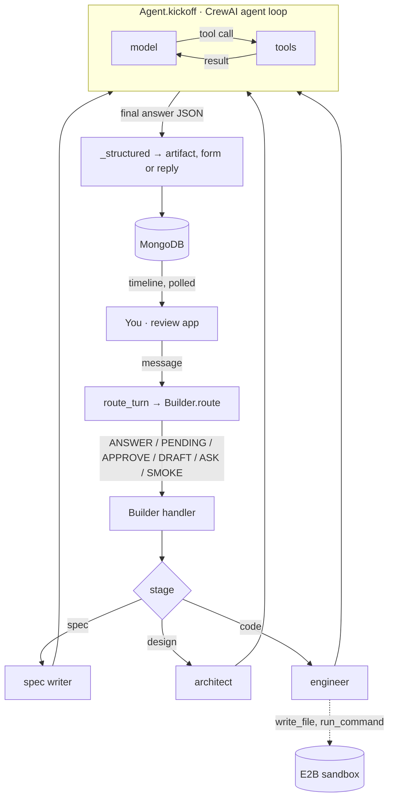
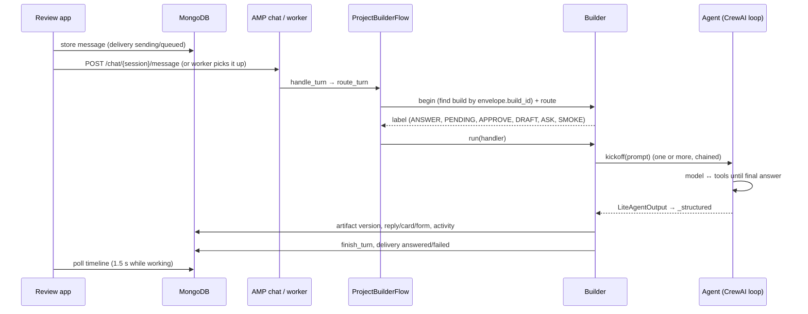
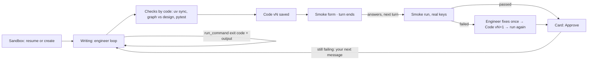

# Project builder: codebase map

> Auto-generated by Cartographer. Last mapped: 2026-10-22T17:40:14Z. Paths are relative to
> `flows/project_builder/`; `src/` means `src/project_builder/`.

The project builder is a CrewAI conversational Flow that builds a CrewAI project in stages (spec → design → code →
tests) through a chat in the review app. Specialist agents (spec writer, architect, engineer) write each stage's
artifact; MongoDB holds everything between turns; the code is written, checked and run in one E2B sandbox per build.

## Where the agentic loop is

There are three loops, nested. Only the innermost one is an agent loop.

```
1 OUTER: turns. One user message = one turn = one flow run. The flow keeps nothing between turns.
   message → AMP chat API (or local worker → turn.py subprocess) → ProjectBuilderFlow.route_turn (src/main.py)
           → Builder.route (src/services/builder.py) → @listen handler → Builder.run → reply/card/form → turn ends
2 MIDDLE: one turn, in the Builder. Routing, then one stage method; stages chain inside the same turn
   (approve spec → architect, approve design → engineer, smoke test failure → engineer fixes once).
   An unsure agent's questions become a form (_ask) and the turn ends; the answers resume the same step next turn.
3 INNER: CrewAI's agent loop, inside one Agent.kickoff (builder._kickoff). The model calls a tool, reads its result,
   and repeats until it gives a final answer or reaches max_iter (then CrewAI forces a final answer).
```



## Directory structure

```
flows/project_builder/
├── src/project_builder/
│   ├── main.py            ProjectBuilderFlow: route_turn + one @listen handler per route; kickoff() = terminal chat
│   ├── turn.py            one turn in its own process (the local worker's unit of work)
│   ├── worker.py          local worker: polls queued messages, runs up to 4 turns at once (one per build)
│   ├── bootstrap.py       App: settings, MongoDB, indexes, Builder (load_dotenv happens here)
│   ├── settings.py        env settings (models, keys, worker concurrency)
│   ├── envelope.py        the JSON a message carries (text, build_id, action, stage, version, answers…)
│   ├── activity.py        the timeline: phases, steps, agents' tool calls routed to their turn by agent id
│   ├── agents.py          spec_writer / architect / engineer, built fresh per call (YAML + CLARIFY + skills + tools)
│   ├── drafts.py          what agents return: RouteDecision, SpecTurn, AskTurn, DesignTurn, CodeTurn, SmokeInput
│   ├── config/agents.yaml roles, goals, backstories
│   ├── services/
│   │   ├── builder.py     the Builder: routing, handlers, stage methods, forms, code stage, smoke test
│   │   ├── sandbox.py     BuildSandbox: one E2B sandbox per build (open/resume, run, snapshot, pause), redaction
│   │   ├── checks.py      by code, in the sandbox: scaffold, checks (uv sync, graph vs design, pytest), smoke run
│   │   └── integrations.py catalogs (crewai_tools, AMP apps), search, design tool checks, AMP connection check
│   ├── tools/
│   │   ├── sandbox.py     engineer: write_file, read_file, list_files, run_command, note
│   │   ├── catalog.py     architect: find_integrations
│   │   └── web.py         architect, engineer: web_search (Exa), only when EXA_API_KEY is set
│   └── skills/            vendored CrewAI skills (bin/update_skills), loaded on demand by agents
├── sandbox/template.py    builds the E2B template `crewai-builder` (latest CrewAI, uv, warm cache)
└── tests/                 offline: mongomock, StubLLM, FakeSandbox, network blocked
```

## The agents

| Agent | Built in | Tools in its loop | Limits | Returns |
|---|---|---|---|---|
| Router | `builder._decide` | none (one call) | 60 s | `RouteDecision` (DRAFT, ASK, APPROVE) |
| Spec writer | `agents.spec_writer` | `load_skill` | max_iter 10 | `SpecTurn` via `response_format` |
| Architect | `agents.architect` | `find_integrations`, `web_search` (≤5), `load_skill` | max_iter 20 | `DesignTurn`, JSON as text + `_structured` |
| Engineer | `agents.engineer` | `write_file`, `read_file`, `list_files`, `run_command`, `note`, `web_search` (≤3), `load_skill` | max_iter 60 | `CodeTurn`, JSON as text + `_structured` |

Every agent call has `LLM(timeout=300)` and `allow_delegation=False`; every backstory ends with the CLARIFY rule
(ask, never guess; never about approving or later stages). `max_execution_time=1_800` on the engineer is **inert**:
CrewAI 1.15.28 applies it only in `Agent.execute_task` (Crew path), not `Agent.kickoff`.

## Turn lifecycle



Routing precedence (`Builder.route`): form answers → `ANSWER`; an open (non-smoke) form → `PENDING`; a gate button
→ `APPROVE` / `DRAFT` / `SMOKE`; otherwise the router LLM. An open smoke form never blocks: any other message
dismisses it.

## The code stage and how errors flow back



Feedback paths for errors in the sandbox:

1. **Inside the engineer's loop** (automatic, up to max_iter): every `run_command` returns `exit N` and the last
   6,000 characters of output to the model, which reads the error and tries again (install, test, fix, rerun). The
   engineer cannot run the project itself (`crewai run`, `kickoff` are refused), so this covers imports, installs and
   its own tests, not the real run.
2. **Smoke test** (automatic, once): a failed run's reason and last 3,000 characters of output go into a new engineer
   turn ("fix it"), a new version is saved, and it runs again with the same inputs.
3. **Your next message** (human-steered, unbounded): when the code's latest smoke test failed, every later
   `_write_code` prompt includes that failure, so "request changes" keeps iterating with the error in view.

Not fed back today: failed **checks** (uv sync, graph mismatches, pytest after the agent's loop) are stored and shown
but don't trigger a fix, and are not in the next prompt (only a failed smoke test is).

## State between turns

| Where | What |
|---|---|
| `builds` | stages, current, `turn` (in progress), `pending_input` (open form, its kind), `sandbox_id`, `seq` |
| `build_messages` | the chat; envelopes; cards; forms (`input_request`) with their answers |
| `build_activity` | the timeline: routes, phases, steps, tool calls, errors, done (tokens) |
| `build_artifacts` | versioned Spec, Design, Code (files, checks, structure, smoke test); `based_on` |
| `build_env` | env var values, Fernet-encrypted (`BUILD_ENV_KEY`); the flow only reads them |
| E2B | the build's sandbox, paused; recreated from the latest code version's files if gone |

Not kept: flow state (no `@persist`), agent memory (prompts are rebuilt from MongoDB), the AMP chat session (the
review app starts a new one when AMP lost it), decrypted values.

## Conventions

- Agents are built fresh for every call; nothing an agent holds outlives the turn.
- Every agent result is `Clarifiable`: questions instead of guesses, turned into a form by code.
- Large schemas (design, code) are given in the prompt and validated by `_structured` (one plain-text repair call);
  small ones use `response_format`.
- Checks and the smoke test are run by code, not by an agent.
- Everything that leaves the sandbox is redacted (`fde_core.vault.scrub`); live output goes through `Batcher`, which
  holds back the tail so a split value never leaves.
- Each code turn logs phases and steps to `build_activity`; that is the live timeline in the UI.

## Gotchas

1. `max_execution_time` doesn't apply to `Agent.kickoff`; the engineer is bounded by max_iter (60), the 300 s LLM
   timeout and each command's timeout (≤900 s). Chained stages share one AMP run (~1 h limit).
2. `ask()` on the code stage answers with the spec writer, which sees only the spec and the history.
3. `note`, `read_file` and `list_files` are logged through the event bus (`note` logs twice); only `write_file`
   and `run_command` are in `SELF_LOGGED`.
4. `exa_api_key` and the platform token exist in `Settings` but are read from `os.environ` (works because
   `bootstrap.app()` loads `.env` first).
5. `Envelope.ref` (selected code lines) is parsed but unused.
6. The flow pins crewai 1.15.28; sandboxes always install the latest CrewAI (`FRESHEN`).
7. The smoke runner kicks off the first `Flow` subclass in `<pkg>.main` (else the crew in `<pkg>.crew`) and passes
   only when it prints its result marker.
8. A turn killed mid-run leaves files in the sandbox; they are snapshotted next time.

## Navigation guide

- **Change how a message is routed:** `services/builder.py` `Builder.route`, `_decide`; `drafts.RouteDecision`; a
  new label needs a `@listen` handler in `main.py`.
- **Change an agent:** persona in `config/agents.yaml`; skills, tools and limits in `agents.py`; its prompt in the
  stage method in `services/builder.py`; its result model in `drafts.py`.
- **Add an engineer tool:** `tools/sandbox.py` (bind to the sandbox, log a step), add it to `sandbox_tools`.
- **Change the checks or the smoke run:** `services/checks.py` (scripts `STRUCTURE`, `SMOKE`; `run_checks`,
  `run_smoke`); the rules in `fde_core.domain.builds` (`structure_mismatches`, `tidy_code`).
- **Change the sandbox:** `services/sandbox.py`; the image in `sandbox/template.py`.
- **Change what the timeline shows:** `activity.py` (phases, steps) and the review app's `CodeTimeline.tsx`.
- **Run tests:** `uv run pytest tests ../../packages/fde_core/tests` (offline).
